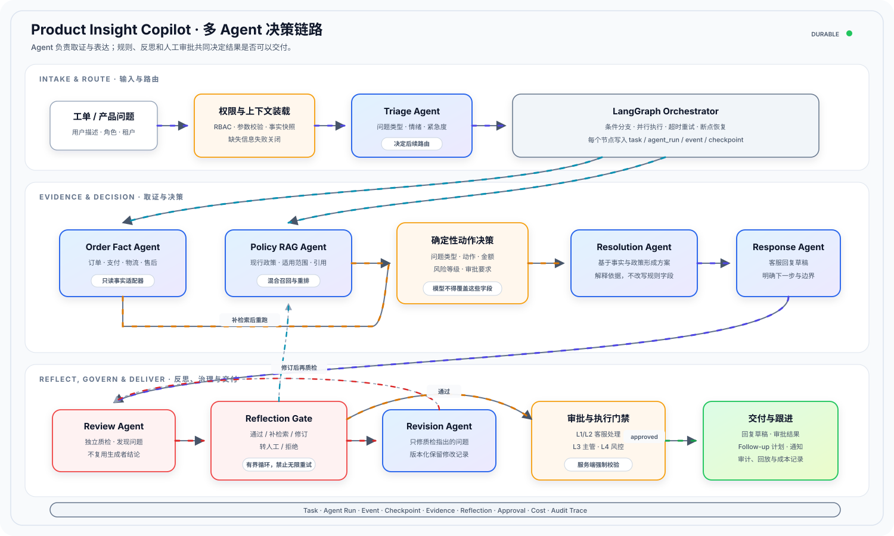
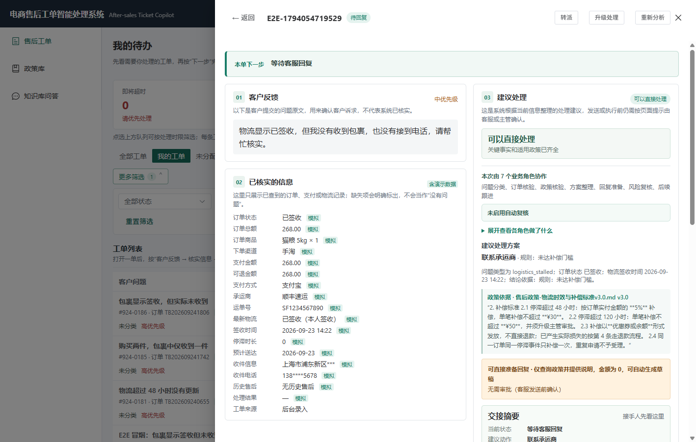
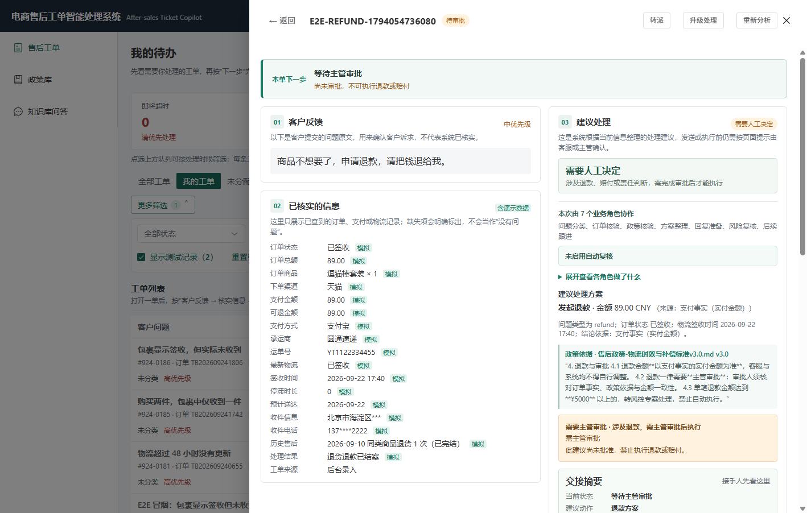

# Product Insight Copilot — 受控多 Agent 售后决策平台

[](https://github.com/Amsit-rick/product-insight-copilot/actions/workflows/ci.yml)

Product Insight Copilot 面向电商售后与互联网产品诊断场景，把订单、支付、物流、售后事实与企业知识库组合成一条可追溯的处理链路。客服提交工单后，多 Agent 会完成问题分类、事实核验、政策检索、方案生成、回复质检和跟进计划，高风险动作必须经过确定性规则与人工审批。

它不是让大模型直接决定退款或修改业务数据。模型负责抽取、归纳和表达；动作、金额、风险等级、审批要求和最终执行权限由服务端规则控制。

## 项目解决什么问题

售后处理真正困难的地方，不是生成一段听起来合理的回复：

- 订单、支付、物流和历史售后记录分散，客服需要反复切换系统核对；
- 同一问题可能命中多版政策，过期或不适用的规则不能进入结论；
- 模型可能把缺失信息当成事实，或在润色时改变动作、金额与风险等级；
- 退款、补偿等高风险动作需要分级审批，不能依赖前端隐藏按钮；
- 一次性聊天无法支持任务暂停、失败恢复、证据追踪和事后回放；
- 多 Agent 如果没有清晰分工和状态记录，用户只会看到“一个聊天机器人”。

Product Insight Copilot 将这些环节拆成受控工作流，并把每个 Agent、工具调用、证据、反思和审批结果写入可审计任务。

## 核心能力

| 能力 | 实现 |
|---|---|
| 售后多 Agent 协作 | Triage、Order Fact、Policy RAG、Resolution、Response、Review、Revision、Follow-up Agent 分工执行；事实与政策可并行取证 |
| 只读事实查询 | 订单、支付、物流和售后适配器默认只读；模型不能直接访问任意 SQL，也不能修改业务数据 |
| 混合 RAG | 文档解析、语义切分、关键词与向量召回、重排、版本/生效期/适用范围过滤及来源引用 |
| 确定性风险治理 | 动作、金额、风险等级和审批要求由代码节点判定；接口层拒绝未批准的高风险执行请求 |
| 完整反思机制 | 独立 Review/Critic 检查证据、政策、金额、动作、审批、引用和回复一致性；支持补检索、有限修订、转人工或拒绝 |
| Human-in-the-Loop | L3/L4 等高风险场景进入主管或风控审核，拒绝后终止后续流程并保留审核记录 |
| Durable Agent | 任务、节点、事件、检查点和结果持久化，支持失败重试、暂停后继续、幂等执行和任务回放 |
| 全链路 Trace | 关联任务、Agent 节点、模型、RAG、事实工具、引用、反思、审批、成本和最终回复 |
| 产品诊断工作流 | 产品知识、用户反馈、版本研发和指标 Agent 并行分析，输出带证据与不确定性说明的诊断报告 |

## 工作链路

<p align="center">
  
</p>

图中的箭头表示真实执行方向，回环表示“补检索或修订后重新质检”。核心原则是：

1. **Agent 分工可见。** 每个节点有独立职责、输入输出和运行记录。
2. **模型没有最终执行权。** 业务动作、金额、风险和审批由确定性规则决定。
3. **证据不足不强答。** 系统会补检索、要求补充信息、转人工或拒绝给出确定结论。
4. **每一步可恢复、可审计、可回放。** 任务状态不会只存在于一次聊天窗口中。

## 可以完成什么

- 创建售后工单，并按“即将超时、等待回复、等待客户补充、待主管审批”处理队列工作；
- 自动核对订单、支付、物流和历史售后事实，缺少订单号时给出可执行的补充入口；
- 检索当前生效且适用的售后政策，并在回复中保留可展开的引用来源；
- 生成客服回复草稿、风险等级、审批要求和后续跟进计划；
- 对回复执行独立反思，发现证据、金额、动作或引用问题时自动补检索或有限修订；
- 在主管工作台审批高风险建议，并由服务端门禁阻止未批准动作；
- 按会话保存知识库问答，重新打开历史会话后继续提问；
- 查看多 Agent 执行步骤、工具调用、反思结果、证据链和任务回放；
- 使用产品知识、用户反馈、版本记录和指标数据生成诊断报告。

## 界面预览

<p align="center">
  
  
</p>

## 快速开始

### 环境要求

- Windows 10/11
- Docker Desktop
- 可选：Python 3.12、Node.js 22（仅本地开发需要）

### Docker 演示模式

在项目根目录打开 CMD：

```cmd
docker compose -f deploy\docker-compose.demo.yml up -d --build
```

启动后访问：

| 服务 | 地址 |
|---|---|
| Web 工作台 | `http://127.0.0.1:8010/` |
| Swagger UI | `http://127.0.0.1:8010/docs` |
| 健康检查 | `http://127.0.0.1:8010/health` |

演示账号：

| 角色 | 用户名 | 密码 | 主要入口 |
|---|---|---|---|
| 客服 | `ops` | `ops123` | 我的待办、工单分析与回复 |
| 主管 | `reviewer` | `reviewer123` | 人工审核、质检与政策维护 |
| 管理员 | `admin` | `admin123` | 诊断平台、系统状态与完整管理入口 |

查看状态和日志：

```cmd
docker compose -f deploy\docker-compose.demo.yml ps
docker compose -f deploy\docker-compose.demo.yml logs -f demo
```

停止演示环境：

```cmd
docker compose -f deploy\docker-compose.demo.yml down
```

演示模式使用 SQLite、stub 模型和虚构数据，不需要模型密钥，也不会产生真实模型费用。它只适合本地体验，不能直接暴露到公网。

### 本地开发

后端，在项目根目录打开 CMD：

```cmd
python -m venv .venv
.venv\Scripts\pip install --require-hashes -r backend\requirements-dev-windows.lock
copy backend\.env.example backend\.env
set PYTHONPATH=%CD%\backend
.venv\Scripts\python -m uvicorn app.main:app --app-dir backend --host 127.0.0.1 --port 8010 --reload
```

新开一个 CMD 启动前端：

```cmd
cd frontend
npm ci
npm run dev
```

本地开发时访问 `http://127.0.0.1:5180/`，前端开发服务器会把 API 请求代理到 `http://127.0.0.1:8010/`。

默认配置使用 stub 模型。接入真实模型、PostgreSQL、Redis、对象存储或企业事实接口时，请参考 `backend/.env.example` 和 `deploy/.env.example`；不要提交真实 `.env`、Token、私钥或生产数据。

## 技术栈

| 层次 | 技术 |
|---|---|
| Agent / LLM | LangGraph、DeepSeek / Qwen 等 OpenAI-compatible 模型、Pydantic 结构化输出 |
| 后端 | Python 3.12、FastAPI、SQLAlchemy |
| RAG | pgvector / fallback vector store、混合召回、Reranker、引用元数据 |
| 状态与队列 | PostgreSQL / SQLite、Redis / memory fallback、Durable Checkpoint |
| 对象存储 | MinIO / S3-compatible storage / local storage |
| 前端 | Vue 3、TypeScript、Vite、Pinia、Element Plus |
| 交付与观测 | Docker Compose、Pytest、CDP E2E、GitHub Actions、Trace 与审计日志 |

## 质量与验证

GitHub Actions 会执行：

- Python 编译、迁移、配置与密钥泄漏检查；
- 后端单元、集成和高风险治理回归；
- 发布报告语句/分支覆盖率门禁；
- 前端 TypeScript 类型检查与生产构建；
- Chrome 浏览器主线、售后角色和可访问性 E2E；
- 镜像供应链、对象存储、远程单机形态和交付证据校验。

仓库内评测数据与演示业务数据均为可重复生成的合成数据。自动化通过证明工程链路可重复运行，不等同于真实企业准确率、生产容量或业务验收。

## 文档导航

| 文档 | 内容 |
|---|---|
| [功能使用说明书](功能使用说明书.md) | 用户角色、页面功能、主流程与常见问题 |
| [界面测试操作手册](界面测试操作手册.md) | 可在页面逐项执行的验收步骤 |
| [发布检查清单](RELEASE_CHECKLIST.md) | 发布前检查、回滚和外部待验收项 |
| [事实接口契约](docs/integrations/fact-http-contract.md) | 订单、支付、物流和售后只读接口约定 |
| [本地集成沙箱](docs/integrations/local-integration-sandbox.md) | 事实、指标和 Webhook 的本地对接环境 |
| [部署说明](deploy/README.md) | Docker Compose、环境变量和运行方式 |
| [测试证据](docs/testing/) | 回归、性能、恢复、供应链与交付验证记录 |

## 目录结构

```text
backend/       FastAPI、LangGraph、Agent、RAG、治理、持久化与测试
frontend/      Vue 3 工作台、审核、知识库问答、回放与管理界面
deploy/        Docker Compose、镜像和发布配置
docs/          架构、集成、测试和产品说明
scripts/       启动、验收、评测、恢复和供应链脚本
.github/       GitHub Actions 工作流
```

## 能力边界

- 本地 stub 模型用于零成本演示，不代表真实模型质量；
- 真实模型、Embedding 和 Reranker 需要在目标业务语料上重新评测；
- 企业订单、支付、物流、售后接口接入前，只能验证本地只读沙箱契约；
- PostgreSQL、Redis、对象存储、多副本、备份恢复和告警需要在目标环境重新验收；
- 生产环境必须使用企业身份体系、最小权限账号、Vault/KMS、集中日志和正式备份策略；
- 关联分析不等同于因果结论，证据不足或冲突时必须保留不确定性并进入人工判断。

在外部依赖、真实数据和人工发布批准完成之前，本仓库应视为可运行的工程演示与集成基线，而不是已获生产授权的系统。
