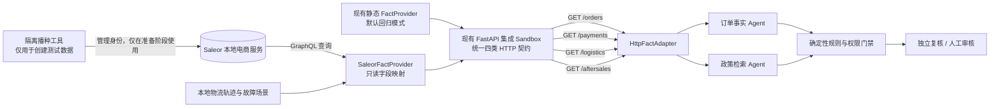

# Saleor 高保真业务 Sandbox 改造任务

日期：2026-11-15
状态：本地工程实施完成；独立人员冷启动验收待执行（Slice 0–4 完成，Slice 5 本地项完成）
规模：Large（新增可选电商上游、事实映射、场景播种、联调与验收）
任务定位：提升本地业务真实性，不替代企业真实接口验收

## 一、决策结论

本轮采用 **Saleor + 现有 FastAPI 集成 Sandbox + 只读事实映射层** 的组合方案：

- Saleor 负责订单、交易、履约、退款等具有状态变化的电商业务数据；
- 现有 FastAPI Sandbox 继续提供本系统已经稳定使用的四类只读 HTTP 契约；
- 物流详细轨迹、异常延迟、坏响应和上游故障继续由本地 Sandbox 注入；
- Agent、LangGraph 和规则引擎不直接依赖 Saleor GraphQL Schema；
- 运行时仅允许查询，不允许 Agent 创建订单、退款、发货或修改业务状态；
- 测试数据由独立播种工具准备，播种身份与运行时查询身份必须分离。

该方案完成后只能称为“开源电商状态机驱动的本地高保真 Sandbox”，不能称为“已接入企业 OMS、支付、物流和售后生产平台”。

## 二、为什么要改造

当前仓库已经具备以下四个标准只读接口：

- `GET /orders/{order_id}`
- `GET /payments/{order_id}`
- `GET /logistics/{order_id}`
- `GET /aftersales/{order_id}`

现有实现已经覆盖鉴权失败、订单不存在、物流超时、非法 JSON、临时不可用和 Webhook 重试等故障场景，适合契约回归和异常测试。

当前不足不是“没有接口”，而是正常场景主要由固定数据返回，尚不能展示同一订单从下单、支付、履约、签收到退货退款的连续状态变化，也不足以验证跨来源事实的一致性。

本轮只解决这个缺口，不扩张为完整商城开发项目。

## 三、业务目标

完成后，应能在本地稳定演示以下能力：

1. 同一个测试订单在订单、支付、物流和售后四类来源中的事实相互一致。
2. 修改测试订单的业务状态后，Agent 下一次分析能够读取新事实，而不是固定 JSON。
3. 退款、物流停滞、少件、重复退款等场景可以由可复现数据驱动。
4. 单个上游来源失败时，系统保留已取得的其他事实，并按现有规则补证据或转人工。
5. 所有业务动作、退款金额、风险等级和审批要求仍由现有确定性规则保护。

## 四、明确不做

- 不开发商城前台、购物车页面、商品运营后台或用户账户体系。
- 不把 Saleor 源码复制进当前仓库，也不修改其核心代码。
- 不让 LangGraph 节点直接调用 Saleor GraphQL。
- 不新增退款、补发、赔付、发券、改价等 Agent 写工具。
- 不用 Saleor 测试支付状态冒充真实支付网关、清算或退款验证。
- 不用本地履约状态冒充真实快递公司运输轨迹。
- 不为追求技术数量同时接入 Saleor、Medusa、ERPNext 等多个平台。
- 不修改当前 `FactAdapter`、HTTP 事实契约和规则引擎的业务边界。
- 不因为本轮本地联调通过而把 `production_ready` 改为 `true`。

## 五、目标架构



核心约束：**Saleor 只替换 Sandbox 的正常事实来源，不进入 Agent 核心依赖，不获得最终决策权。**

## 六、技术边界与数据所有权

### 6.1 运行模式

建议为独立 Sandbox 增加可配置事实提供方：

```text
SANDBOX_FACT_PROVIDER=static   # 默认，保持现有快速回归
SANDBOX_FACT_PROVIDER=saleor   # 可选，高保真业务联调
```

- `static` 必须继续作为默认值，确保现有测试不依赖重型外部服务。
- `saleor` 只在显式启用对应 Docker profile 时可用。
- Saleor 不可用时不得静默返回静态成功数据；应返回结构化 `adapter_unavailable`，避免产生伪证据。

### 6.2 身份分离

| 身份 | 权限 | 使用位置 |
|---|---|---|
| 场景播种身份 | 创建测试订单、交易、履约与退款场景所需的最小权限 | 仅播种命令或一次性容器 |
| Sandbox 查询身份 | 仅读取订单、交易、履约和售后相关字段 | `SaleorFactProvider` |
| 主系统身份 | 只能访问现有四个 Sandbox HTTP GET 接口 | `HttpFactAdapter` |

主应用容器不得获得播种凭据；日志、健康检查、前端和证据文件不得回显任何 Token。

### 6.3 标准事实映射

映射层继续输出现有 `fact-http-contract.md` 定义的字段，不把 Saleor 私有 Schema 暴露给 Agent：

| 标准来源 | 预期上游事实 | 必须保持的约束 |
|---|---|---|
| 订单 | 状态、总额、订单行、渠道、商品类别 | 金额使用字符串；地址和手机号在出口脱敏 |
| 支付 | 已支付金额、可退金额、支付渠道、交易状态 | 不能由模型推算可退金额 |
| 物流 | Fulfillment、tracking number、签收状态 | 详细轨迹和停滞时长由本地 overlay 生成并标记来源 |
| 售后 | 退款/退货记录、最近处理结果、活动核算辅助事实 | 无法从 Saleor 直接取得的字段必须显式缺失，禁止猜测 |

Saleor 的具体字段、权限和版本兼容性必须在 Slice 0 实测确认后冻结；任务书不提前把未经验证的 GraphQL 字段写成既定事实。

## 七、实施切片

### Slice 0：兼容性 Spike 与决策冻结（10%）

实施状态：**已完成（2026-11-15）**。实测证据及冻结决策见
`docs/architecture/adr-003-saleor-commerce-sandbox.md`。

目标：先证明 Saleor 值得接入，避免先写大量适配代码。

任务：

- 选择并固定 Saleor 与部署模板版本，记录许可证和镜像来源。
- 在当前 Windows + Docker 环境启动官方本地栈。
- 通过官方 API 完成一条最小链路：创建测试数据、支付状态、履约状态、退款状态、只读查询。
- 记录 GraphQL 查询、最小权限、冷启动时间、稳定内存占用和停止/清理方式。
- 确认哪些字段来自 Saleor，哪些必须由本地物流/售后 overlay 补充。
- 形成简短 ADR；未通过本切片不得进入正式适配器开发。

验收：

- 连续三次可以按文档从空环境启动并完成最小链路。
- 没有手工修改容器内部文件或数据库才能运行的隐藏步骤。
- 能提供运行时只读身份；若 Saleor 权限模型不能做到严格只读，必须通过网络隔离、查询白名单和应用层拒绝 Mutation 共同补偿并记录风险。

停止条件：

- 官方本地栈在当前环境无法稳定启动；
- 关键订单/交易/履约状态无法通过受支持 API 查询；
- 资源开销明显影响当前主系统演示；
- 需要修改 Saleor 核心代码才能满足最小链路。

触发停止条件时，不立即换接第二套大型平台，先回退为“增强现有 FastAPI 状态机”的轻量方案并重新评审。

### Slice 1：可选本地运行环境（20%）

实施状态：**已完成（2026-11-15）**。已提供默认关闭的独立 Compose profile、
隔离数据卷/网络、幂等播种、运行时 App 身份、CMD 入口及定向重置。

任务：

- 增加独立、默认关闭的 `commerce-sandbox` Docker profile。
- 使用固定版本或镜像 digest，不使用不受控的 `latest`。
- Saleor 数据库、缓存和网络与主系统生产形态隔离。
- 提供启动、健康检查、播种、重置和停止的 CMD 命令。
- 启动失败不得影响当前默认全栈和静态 Sandbox。

验收：

- 不启用 profile 时，现有 Compose 服务数量和行为不变。
- 启用后，健康状态能区分 `static`、`saleor_ready`、`saleor_unavailable`。
- 清理命令只删除本地测试数据卷，不触碰主系统 PostgreSQL、Redis、MinIO 或用户文件。

### Slice 2：SaleorFactProvider 与字段映射（25%）

实施状态：**已完成（2026-11-15）**。默认静态 Provider 行为保持不变；
Saleor Provider 只使用固定 Query，已实现四类映射、超时/重试/响应大小限制、
结构校验、结构化错误和不静默回退。

任务：

- 在独立 Sandbox 内新增 `FactProvider` 协议。
- 把现有固定返回实现迁移为 `StaticFactProvider`，行为保持不变。
- 新增 `SaleorFactProvider`，只允许固定查询，不接受动态 GraphQL 文本。
- 为订单、支付、履约、售后分别建立显式字段映射和允许字段白名单。
- 增加查询超时、有限重试、响应大小限制、Schema 校验和脱敏。
- 上游部分缺失时返回真实缺失状态，不使用静态数据补成功。
- 保留 `X-Request-ID`，记录上游观测时间和数据来源版本。

验收：

- 当前四个 HTTP 路径和响应契约不变。
- Agent 侧不新增 Saleor SDK，不修改 LangGraph 节点调用方式。
- GraphQL Mutation、Introspection 和任意查询字符串均不能由主系统触发。
- Saleor 不可用、超时、返回异常和字段缺失均有确定性错误语义。

### Slice 3：可复现业务场景与播种工具（20%）

实施状态：**已完成（2026-11-15）**。已生成十个唯一场景别名，场景清单由
Saleor 本地订单摘要确定性构建；官方样例缺失的物流、售后和冲突信息由显式标注的
local scenario overlay 补齐。清单写入专用 Docker volume，运行时只读挂载，公开
`GET /scenarios` 仅返回安全元数据。自动验收结果为 43/43，通过十场景四来源共
40 次真实 HTTP 查询，证据见
`docs/testing/artifacts/saleor-commerce-sandbox-slice3-local.json`。

至少准备以下十类匿名合成场景：

| 场景 | 关键事实 |
|---|---|
| 正常已签收 | 已支付、已履约、已签收、无售后 |
| 未支付取消 | 订单取消、无成功支付、不可退款 |
| 已支付未发货退款 | 已支付、未履约、满足退款核验 |
| 部分发货 | 多订单行、仅部分 Fulfillment |
| 物流停滞 | 已发货、轨迹长时间未更新 |
| 已签收退货 | 有签收事实和退货记录 |
| 部分退款 | 已支付金额大于已退款金额 |
| 重复退款请求 | 已存在成功退款记录 |
| 少件/漏发 | 订单行与履约数量不一致 |
| 跨来源冲突 | 订单显示已支付但交易状态异常，用于验证冲突检测 |

规则：

- 所有订单号、客户号、地址和手机号均为合成数据。
- 播种必须幂等；重复执行不能无限创建重复订单。
- 生成场景清单和匿名测试标识映射，但不得保存凭据。
- 场景状态变化必须来自播种/场景控制工具，不由 Agent 写入。

验收：

- 每个场景可以独立重置和复现。
- 四类事实能够通过同一订单标识关联。
- 预期事实和 Agent 最终结论分别验证，不能用最终答案反推或硬编码上游数据。

### Slice 4：故障注入与主系统联调（15%）

实施状态：**已完成（2026-11-15）**。主系统在隔离临时 SQLite、`LLM_PROVIDER=stub`、
`TASK_EXECUTION_BACKEND=inline` 下，以 `TICKET_USE_MOCK_ADAPTERS=false` 通过真实 HTTP
访问 Saleor 高保真 Sandbox。十类业务场景 10/10、六类技术故障场景 6/6 通过；
四类事实均保留 `saleor-3.23.49+scenario-v1` 来源版本并进入 Task Trace。部分退款使用
剩余可退金额，重复退款、跨来源冲突和任一事实来源异常均不会生成退款动作。退款动作仍为
L3/主管审批，反思修订次数不超过配置。机器证据见
`docs/testing/artifacts/saleor-commerce-sandbox-slice4-local.json`。

任务：

- 保留现有 401、404、超时、429、5xx、坏 JSON 和非法时间场景。
- 新增 Saleor 上游不可达、查询超时、字段缺失和跨来源冲突场景。
- 使用 `TICKET_USE_MOCK_ADAPTERS=false` 和现有 `HttpFactAdapter` 跑完整售后流程。
- 验证单来源失败时不会覆盖其他来源事实，不会自动生成退款承诺。
- 验证反思、补检索、有限修订、人工审核和 Trace 中的数据来源标记。

验收：

- 四类事实契约测试全部通过。
- 十类正常/业务异常场景端到端通过。
- 至少六类技术故障场景端到端通过。
- 敏感字段、GraphQL 请求正文和 Token 不进入前端、普通日志和测试制品。

验证结果：

- 相关单元/集成回归 155 通过、0 失败；
- 核心改造模块合计覆盖率 81%；
- E2E 业务场景 10/10、技术故障 6/6；
- 证据制品只保存场景 ID、来源版本、错误码、动作类型和布尔检查结果，不保存事实值、
  上游订单映射、Token、GraphQL 正文或客户 PII。

### Slice 5：评测、文档与证据边界（10%）

实施状态：**本地工程项已完成（2026-11-16）**。新增安全指标汇总和 Slice 5 机器证据；
扩展后的 Saleor 相关回归 187 通过，主系统业务 10/10、故障 6/6。README、架构、启动手册、演示脚本和
交付状态已按三层证据口径更新。尚缺“未参与开发的人”实际按文档完成一次冷启动演示记录，
因此不伪造最终独立验收结论。

为支持最后的独立验收，已增加默认阻塞的记录模板、原始证据 SHA-256 绑定验证器和 CI Compose
静态解析。验证器只能校验记录与证据一致性，不能替组织证明人员身份，因此专项进度仍保持 99%。

任务：

- 增加字段映射单元测试、Provider 契约测试和端到端回归。
- 记录成功率、P50/P95 查询延迟、失败类型和人工接管原因。
- 更新本地启动文档、系统架构、产品演示脚本和交付状态。
- 生成机器可读的本地联调证据，固定标记：
  - `environment=local_high_fidelity_sandbox`
  - `enterprise_endpoint_verified=false`
  - `real_payment_verified=false`
  - `real_carrier_verified=false`
  - `production_ready=false`

验收：

- 新环境可以由未参与开发的人按文档启动和完成演示。
- 静态 Sandbox、Saleor 高保真 Sandbox 和企业真实接口三种证据口径不混用。
- README 和公开说明不出现“已接入真实企业 OMS/支付/物流”的虚假描述。

## 八、防走偏门禁

以下任一变更在实施前必须先更新本任务并说明理由：

1. 修改现有四类 HTTP 事实契约。
2. 让 Agent 或模型执行 GraphQL Mutation。
3. 把 Saleor SDK 引入主应用或 LangGraph 节点。
4. 同时引入第二套完整电商平台。
5. 开发商城 UI、商品运营、会员或营销系统。
6. 用固定答案替代真实状态查询以追求评测通过率。
7. 把本地 Sandbox 结果计入企业生产门禁。
8. 将播种账号、管理员 Token 或测试用户隐私信息提交到 Git。
9. 因 Saleor 字段缺失而让模型自行补全订单、支付或退款事实。
10. 为了展示“多 Agent”而新增与业务职责没有独立输入输出边界的 Agent。

代码评审必须逐项检查上述门禁；违反任一项时暂停实施，而不是继续堆功能。

## 九、回退策略

如果 Slice 0 证明 Saleor 在当前环境不合适，回退方案不是马上接入另一套大型系统，而是：

1. 保留现有四类 HTTP 契约；
2. 在独立 Sandbox 中增加 SQLite/PostgreSQL 驱动的轻量订单状态机；
3. 使用同一套十类场景和故障验收；
4. 等真实企业 Sandbox 可用后，仅替换 `FactProvider`。

回退不得修改 Agent 核心调用方式，也不得降低现有安全门禁。

## 十、完成定义

本任务只有同时满足以下条件才算完成：

- Saleor 可选环境能重复启动、播种、查询、重置和停止；
- 现有默认开发环境和静态 Sandbox 不受影响；
- 十类业务场景与六类故障场景都有自动化验证；
- Agent 运行时只有只读事实访问能力；
- 金额、动作、风险和审批继续由确定性代码保护；
- 查询来源、观测时间、错误和 Trace 可以关联；
- 没有凭据和合成客户明文进入仓库或普通日志；
- 文档清楚区分本地高保真 Sandbox、企业真实接口和生产就绪；
- `production_ready` 继续保持 `false`，直到真实企业端点及其他外部门禁独立验收完成。

## 十一、量化进度口径

本专项只按上述切片计算，不与项目整体生产准备度混算：

| 切片 | 权重 |
|---|---:|
| Slice 0：兼容性 Spike | 10% |
| Slice 1：可选运行环境 | 20% |
| Slice 2：Provider 与字段映射 | 25% |
| Slice 3：业务场景与播种 | 20% |
| Slice 4：故障注入与联调 | 15% |
| Slice 5：评测、文档与证据 | 10% |

当前 Slice 0–4 完成，Slice 5 的代码、自动化和文档完成；按本专项口径为 **99%**。
剩余 1% 是独立人员冷启动演示记录，不属于可由当前开发者自证的代码工作。该百分比不表示生产
准备度；`production_ready` 仍为 `false`。

每轮汇报必须同时说明：

- 本专项完成度；
- 本轮完成的验收证据；
- 尚未完成的任务和真实阻塞；
- 是否使用静态数据、Saleor 本地数据或企业真实数据；
- `production_ready` 是否变化以及变化依据。

在没有企业真实端点、独立人工 holdout、真人客服测试和跨主机生产证据前，不得通过主观百分比提高生产准备度。

## 十二、建议实施顺序

严格按以下顺序推进：

1. Slice 0 兼容性 Spike；
2. 评审 Spike 结果并冻结版本与字段边界；
3. Slice 1 可选运行环境；
4. Slice 2 Provider 与字段映射；
5. Slice 3 场景播种；
6. Slice 4 主系统与故障联调；
7. Slice 5 评测、文档和证据收口。

不得跳过 Slice 0 直接大规模开发，也不得在自动化验收未完成前修改公开说明和 README 的能力表述。
