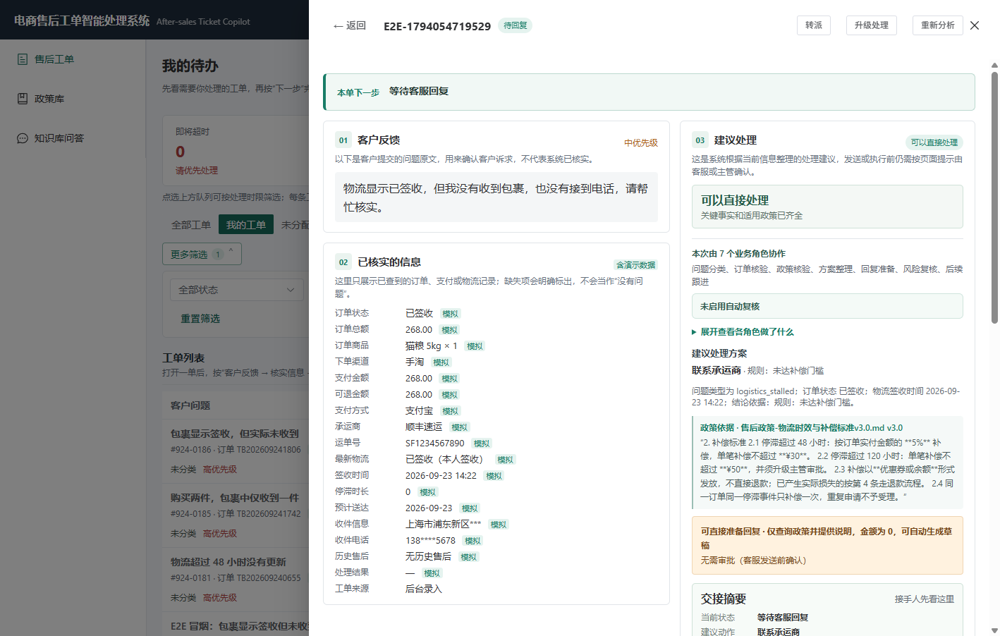
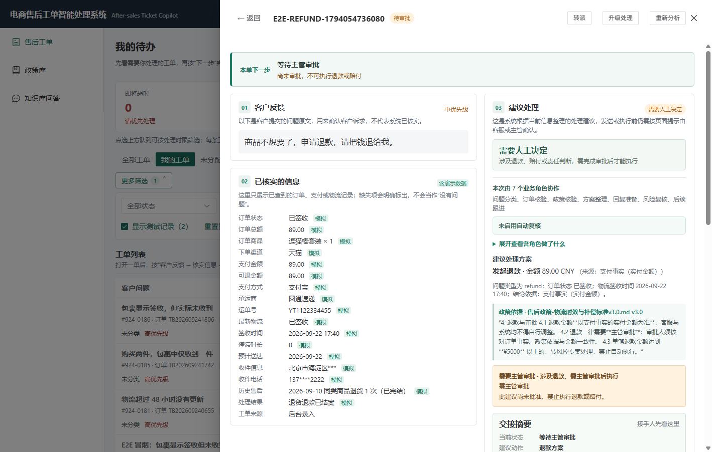

# 公开演示运行手册（本地 / 隔离库）

日期：2026-11-08
目标：任何人拿到仓库后，能在 5 分钟内启动一套**不花钱、不碰开发库、数据可重置**的售后工单演示。

> 这不是公网部署方案。对公网开放需要独立租户、只读账号、限流、脱敏和审计，见文末"公网边界"。

## 0. 一键启动（推荐）

仓库根目录执行：

```powershell
powershell -NoProfile -ExecutionPolicy Bypass -File scripts\demo.ps1
# 清空演示库重来：-Reset
# 只准备数据不启动：-NoServe
# 换端口：-Port 8011
```

脚本会使用**隔离 SQLite + stub 模型 + 内存缓存**，不读取 `backend/.env` 的真实 Key，也不会碰开发库。
首次运行自动建库/播种；`/health` 返回 ok 后打开 <http://127.0.0.1:8010/> 即可。

只装了 Docker 时：

```powershell
powershell -NoProfile -ExecutionPolicy Bypass -File scripts\demo_docker.ps1 -Build
# 清空重来：-Reset；换端口：-Port 8011
```

编排说明与公网清单见 [公开演示交付包](公开演示交付包-2026-11-08.md)。

## 1. 手动启动（需要自定义环境时）

前置：Python 3.12、Node 20+，仓库根目录已存在 `.venv`。

```powershell
cd backend
$env:PYTHONPATH = $PWD
$env:LLM_PROVIDER = "stub"                 # 零成本，不调用真实模型
$env:DATABASE_URL = "sqlite:///D:/path/to/product-insight-copilot/backend/.tmp/public-demo.db"
..\.venv\Scripts\python.exe -m app.db.seed --reset
..\.venv\Scripts\python.exe -m uvicorn app.main:app --host 127.0.0.1 --port 8010
```

打开 <http://127.0.0.1:8010/>。前端产物由后端同源托管；改了前端先执行：

```powershell
cd frontend
npm.cmd run typecheck
npm.cmd run build
```

## 2. 演示账号（虚构数据）

| 账号 | 口令 | 角色 | 演示用途 |
|---|---|---|---|
| `ops` | `ops123` | 客服 | 我的待办、分析、改草稿、转派 |
| `reviewer` | `reviewer123` | 售后主管 | L3/L4 审批、质检抽查、政策库 |
| `admin` | `admin123` | 管理员 | 系统状态、队列、审计、评测 |

## 3. 3 分钟演示（按 [演示脚本](../../演示脚本-3分钟.md) 执行）

1. `ops` 登录 → 售后工单 → 打开 `TK-260924-0181`（物流停滞）→ 看事实、政策、草稿；
2. 打开 `TK-260924-0184`（退款）→ 指出 L3、金额来源、只有「主管审批」；
3. `reviewer` 登录 → 审批填理由 → 工单进入待回复；
4. `ops` 发送 → 工单已解决 → 审计记录可回放；
5. 侧栏「政策库」→ v3.0 可用 / v1.0 已失效 / v4.0 未生效，检索测试显示被排除版本。

## 4. 两分钟录屏分镜

| 时间 | 画面 | 操作 | 旁白要点 |
|---|---|---|---|
| 0:00–0:15 | 工单列表 | `ops` 登录，停在“我的待办” | 客服每天先看“下一步做什么”，不是看 Agent 日志 |
| 0:15–0:45 | 工单详情 | 打开 `TK-260924-0181` | 订单事实带来源和观测时间；政策只命中现行版本 |
| 0:45–1:10 | 建议处理 | 指向金额来源与风险框 | 金额来自支付事实/政策，不是模型算的 |
| 1:10–1:35 | 退款工单 | 打开 `TK-260924-0184` | L3 只有主管审批，未批准无法发送 |
| 1:35–1:55 | 主管审批 | `reviewer` 登录审批 | 谁批、何时、理由全部进审计 |
| 1:55–2:00 | 政策库 | 展示失效/未生效版本被排除 | 政策合规不是靠提示词，是检索层过滤 |

录屏要求：1440×900 以上、浏览器缩放 100%、只使用演示租户；不要出现真实客户信息、密钥、终端历史。

## 5. 截图

客服工单详情（E2E 隔离库，虚构数据）：



L3 退款审批门禁（未批准不可发送）：



## 6. 公网边界

本地 demo 可以直接跑；**公网 demo 不能直接暴露这套配置**：

- 演示账号口令是公开的，必须换成一次性只读账号或邀请制；
- 需要独立租户 + 独立库，避免演示数据污染真实数据；
- 需要限流、WAF、审计和自动清理；
- 真实模型模式下必须设置预算上限，避免被刷；
- 不能把 `backend/.env`、真实订单号、客户信息带进镜像或截图。

当前仓库提供的是**本地可复现 demo**，不是已上线的公网服务。
